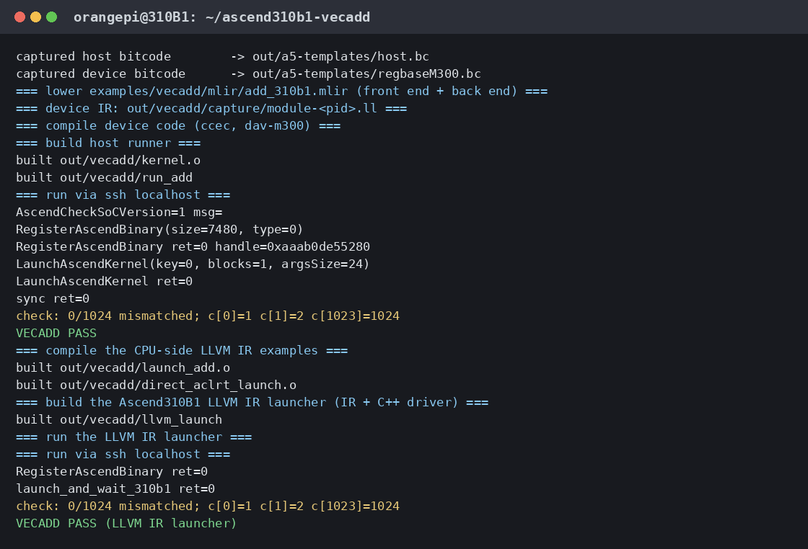

# Ascend310B1 vecadd：AscendNPU-IR + hivmc 部署、编译与算子执行

目标：在一台 Ascend310B1（`dav-m300`，香橙派 20T + CANN 9.0.0）上

1. 从源码编译或从二进制包部署 AscendNPU-IR 的前端 `bishengir-compile` 与设备后端 `hivmc`；
2. 用它们把 **vecadd 算子**（AscendNPU-IR 表示的 MLIR）编译成可执行内核 `kernel.o`；
3. 用 C 示例程序与 LLVM IR launcher 在设备上正确调用并校验结果。



上图是 `./scripts/99_verify.sh` 的真实输出：C 示例与 LLVM IR launcher 都是
`0/1024 mismatched`、`VECADD PASS`。

详细文档：
[工具链构建与模板 bitcode](docs/01-toolchain-build.md) ·
[算子编译流水线与容器格式](docs/02-vecadd-pipeline.md) ·
[用 LLVM IR 调用 vecadd](docs/03-llvm-ir-launch.md)

## 0. 结论速览

**快速部署**：已有 Ubuntu 22.04 aarch64、CANN 9.0.0 和 310B 驱动时，可从
[GitHub Release](https://github.com/zkdliushuo/orangepi-ascendnpuir-examples/releases/tag/toolchain-v1.2.0-310b1-20261123)
下载预编译工具链，按[工具链部署文档](docs/01-toolchain-build.md#02-方式一从-github-release-部署二进制)
完成下载、SHA256 校验、解压、安装和上板测试。二进制包不含 CANN、驱动或模板 bitcode。
需要修改编译器时，使用同一文档中的源码编译流程。

| 项目 | 选择 | 原因 |
| --- | --- | --- |
| 前端 `bishengir-compile` | 分支 `dev/regbase`（BiShengIR 1.2.0） | 该分支注册了 `--target=Ascend310B1..B4`，`Ascend310B_BaseSpec.Arch = "dav-m300"` |
| 后端 `hivmc` | 分支 `master`（同样 1.2.0） | `dev/regbase` 本身**不含** hivmc，它按名字调用外部 `hivmc-a5`；开源树里只有 master 带 A5 后端 |
| 设备编译器 | CANN 9.0.0 自带 `ccec`/`bisheng` | 属于 CANN 工具链，不在 AscendNPU-IR 仓库内 |
| 需要打的补丁 | 4 个 GCC 兼容 + 1 个 A5 arch + 1 个链接分组 | 见第 6 节 |
| 运行时必须做的两处修改 | 内核入口注解、AscendC 容器格式 | 见第 6.2 / 6.3 节 |

一键验证（工具链已构建好时）：

```bash
./scripts/99_verify.sh
```

首次从零构建工具链：

```bash
BUILD_TOOLCHAIN=1 ./scripts/99_verify.sh     # 3 核机器上大约 6~8 小时
```

## 1. 工作区布局（全部使用相对路径）

仓库假定自己位于一个"工作区"里，所有外部依赖都在**同级目录**下，因此任何脚本和
命令都不需要写绝对路径：

```
<workspace>/
├── deps/
│   ├── AscendNPU-IR/             # 上游仓库（master 检出，用于构建 hivmc）
│   ├── AscendNPU-IR-a5/          # dev/regbase 的 git worktree（用于构建前端）
│   ├── cann-9.0.0/               # CANN 9.0.0 toolkit 安装目录
│   └── build-ascendnpu-ir/       # 共享的 LLVM/MLIR + bishengir 构建目录
└── ascend310b1-vecadd/           # 本仓库
    ├── scripts/                  # 构建与运行脚本
    ├── patches/                  # frontend/ 与 hivmc/ 的补丁
    ├── examples/vecadd/          # MLIR 算子、C 示例、LLVM IR 示例
    └── docs/                     # 详细说明与运行截图
```

工作区根目录默认取本仓库的父目录，可用环境变量覆盖（见 `scripts/00_env.sh`，
或创建一个 git 忽略的 `scripts/config.local.sh`）。

## 2. 安装依赖

### 2.1 系统软件包

```bash
sudo apt-get update
sudo apt-get install -y \
    build-essential cmake ninja-build git python3 python3-pip zlib1g-dev

# AscendNPU-IR 要求：cmake >= 3.28、ninja >= 1.12
cmake --version
ninja --version
```

### 2.2 CANN 9.0.0 toolkit 与 310B 算子包

从昇腾社区下载 aarch64 版本的两个包：`Ascend-cann-toolkit_9.0.0_linux-aarch64.run`
与 `Ascend-cann-kernels-310b_9.0.0_linux.run`，安装到工作区的 `deps/` 下：

```bash
mkdir -p ../deps
cd ../deps
./Ascend-cann-toolkit_9.0.0_linux-aarch64.run --install --install-path=. --quiet
./Ascend-cann-kernels-310b_9.0.0_linux.run       --install --install-path=. --quiet
# 安装完成后目录形如 ../deps/cann-9.0.0（以及 ../deps/cann 软链）
ls ../deps/cann-9.0.0/bin/bishengir-compile-a5
source ../deps/cann-9.0.0/set_env.sh
```

设备驱动由设备镜像/驱动包提供（默认装在 `/usr/local/Ascend/driver`，
可用 `ASCEND_DRIVER_DIR` 覆盖），**不属于** CANN toolkit，本仓库不重新安装它。

### 2.3 设备权限

`/dev/davinci0` 属于 `HwHiAiUser`，`/dev/davinci_manager` 属于 `HwBaseUser`：

```bash
sudo usermod -aG HwHiAiUser,HwBaseUser,HwDmUser "$(whoami)"
```

**必须重新登录**后新组才会生效。若不方便重新登录，本仓库的脚本支持通过一个新会话
执行上板程序：

```bash
ASCEND_SSH=localhost ASCEND_SSH_OPTS="-i .ssh/<你的私钥>" ./scripts/21_run_vecadd.sh
```

（`ASCEND_SSH_OPTS` 可选，用于指定私钥或 `-o StrictHostKeyChecking=no` 等。）

### 2.4 源码

```bash
cd ../deps
git clone https://github.com/Ascend/AscendNPU-IR.git AscendNPU-IR
cd AscendNPU-IR
git submodule update --init --recursive third-party/llvm-project
git fetch origin dev/regbase
git worktree add ../AscendNPU-IR-a5 origin/dev/regbase

# dev/regbase 的 worktree 复用 master 的子模块（LLVM/torch-mlir/shmem）
cd ../AscendNPU-IR-a5
mkdir -p third-party
ln -sfn ../../AscendNPU-IR/third-party/llvm-project third-party/llvm-project
ln -sfn ../../AscendNPU-IR/third-party/shmem        third-party/shmem
ln -sfn ../../AscendNPU-IR/third-party/torch-mlir   third-party/torch-mlir
```

## 3. 编译前端 `bishengir-compile`

```bash
cd ../../ascend310b1-vecadd
./scripts/10_build_frontend.sh
```

脚本做的事：

1. 对 `deps/AscendNPU-IR-a5` 应用 `patches/frontend/*.patch`（幂等，已打过会跳过）；
2. 用 `deps/AscendNPU-IR` 的 LLVM/MLIR 源码、以
   `-DLLVM_EXTERNAL_BISHENGIR_SOURCE_DIR=../deps/AscendNPU-IR-a5/bishengir`
   配置共享构建目录 `deps/build-ascendnpu-ir`；
3. `ninja bishengir-compile`，产物复制到 `out/bin/bishengir-compile`。

产物自检：

```bash
./out/bin/bishengir-compile --version
./out/bin/bishengir-compile --help | grep Ascend310B
```

## 4. 编译后端 `hivmc`

```bash
./scripts/11_build_hivmc.sh
```

要点（脚本已处理）：

1. 需要 `-DBISHENGIR_BUILD_HIVMC=ON -DLLVM_INCLUDE_TESTS=ON -DMLIR_INCLUDE_TESTS=ON`
   （hivmc 的 CMakeLists 无条件链接 `MLIRTestTransforms` 等测试库）；
2. `SkewShapeTable.inc` 由自定义命令生成，但对象库没有声明该依赖，并行构建会竞态，
   脚本在编译前预生成；
3. BiShengIR/Triton 的静态库互相成环，CMake 生成的链接命令行最后一组库没有被
   链接分组包住，脚本用 ninja 自己的链接命令重新链接
   （`-Wl,--start-group ... -Wl,--end-group`），产物复制到 `out/bin/hivmc`；
4. 它与第 3 步共享同一个 LLVM/MLIR 构建目录，因此 LLVM 只编译一次。

## 5. 抓取 A5 模板 bitcode

```bash
./scripts/05_capture_a5_templates.sh
```

设备编译需要两份模板 bitcode：`host.bc`（CANN 直接提供）和 `regbaseM300.bc`
（CANN 没安装成文件）。脚本用"替换 `bisheng` 的捕获 shim"跑一次 CANN 自带的
`bishengir-compile-a5`，把它传给设备编译器的 `-cce-link-aicore-ll-module <file>.bc`
保存下来，输出到 `out/a5-templates/`。

关于"模板"到底指什么、为什么只能抓取而不能直接下载、以及它在哪一步被使用，
见 [docs/01-toolchain-build.md 第 3 节](docs/01-toolchain-build.md#3-模板-bitcode-是什么为什么要抓)。

## 6. 编译 `add` 算子

```bash
./scripts/20_build_vecadd.sh
```

流水线（输入 `examples/vecadd/mlir/add_310b1.mlir`，1024 个 i16 的向量加）：

```
add_310b1.mlir
   │  bishengir-compile --target=Ascend310B1（自建前端）+ hivmc（自建后端）
   ▼
设备 LLVM IR（out/vecadd/capture/module-*.ll）
   │  补内核入口注解（6.2）
   ▼
kernel.annotated.ll
   │  ccec --cce-aicore-arch=dav-m300 + ld.lld -m aicorelinux
   ▼
kernel.linked.o
   │  AscendC 容器格式（6.3）
   ▼
out/vecadd/kernel.o          ← 运行时可注册/启动的内核
```

### 6.1 IR / 代码生成阶段

* **前端必须清楚 310B1 的目标特性**：`dev/regbase` 的
  `Ascend310B_BaseSpec` 把 `Arch` 设为 `dav-m300`，并给出 UB/L1/L0 容量与对齐要求，
  这些信息决定向量长度、分块与同步的生成方式。用不带 A5 支持的编译器（例如 issue
  里提到的"后端不支持 dav-300m"）就会在代码生成阶段直接失败或生成错误指令。
* **前后端版本必须匹配**：1.2.0 的前端会把生成的库调用声明标成 `hacc.noinline`，
  而 CANN 9 自带的 `hivmc-a5` 是 1.0.0，遇到该属性直接报
  `'llvm.func' op Unsupported attribute type: "hacc.noinline"`。把后端也换成
  1.2.0（master 构建）后，该属性被正确翻译成 LLVM 的 `noinline` 属性，
  不再需要 `--enable-lib-call-no-inline=false` 这类绕行参数。
* **A5 设备架构字符串**：master 的 A5 后端把设备架构硬编码成 `dav-c220`（Ascend950
  才是 `dav-c310`），310B1 会被交给 `ccec` 当作 `dav-c220-vec` 编译，直接报
  `error in backend: Do not know how to split the result of this operator!`。
  补丁改成：`isAscend310B(target)` 为真时使用 `dav-m300`。

### 6.2 设备 LLVM IR：补内核入口元数据

内核对 CPU 来说不是可直接 `call` 的符号，设备编译器需要元数据才知道"这是内核入口、
要生成参数前导（prologue）"。AscendC 编译出来的 IR 里有：

```llvm
!hivm.annotations = !{!1}
!1 = !{ptr @add, !"kernel", i32 1}
```

而 AscendNPU-IR 流水线产出的设备 IR **没有**这段元数据（`hacc.entry` 没被
落到 IR 上）。缺失的后果：`ccec` 不生成参数前导，核心里直接用寄存器里的垃圾当
设备地址，运行时报 `DDR address of the MTE instruction is out of range`。
`examples/vecadd/tools/patch_310b1_annotation.py` 负责补上它。

### 6.3 目标文件：AscendC 运行时要求的"容器"格式

AscendC 运行时（`libascendc_runtime.a` 的 `RegisterAscendBinary` / `LaunchAscendKernel`）
对裸设备 ELF 有三条硬性要求，缺一个就返回 `107000` 或设备异常：

| 要求 | 原因 |
| --- | --- |
| 入口符号必须是 `<name>_<tilingkey>`（这里是 `add_0`），且 `st_size` 不能为 0 | 运行时用入口符号的 `st_size` 当作内核代码长度 |
| `__CCE_KernelArgSize` 节里要有 `<name>_<tilingkey>__`（4 字节 OBJECT），值为参数区大小 | 运行时按它准备参数块；本例 3 个指针 = 24 字节 |
| 注册类型必须为 mix（`type=0`），SoC 字符串小写 `ascend310b1` | 否则 `507035/507015` 或不匹配 |

`scripts/20_build_vecadd.sh` 用 `ld.lld` + `llvm-objcopy` 完成
（`--redefine-sym add=add_0` 保留编译器给的 `st_size`，不要用 `--add-symbol`）。

## 7. 编译并运行 C 示例

`examples/vecadd/src/vecadd_runner_310b1.cpp` 就是示例程序：它做 ACL 初始化、
分配设备内存、`RegisterAscendBinary` 注册 `kernel.o`、用 24 字节参数块
`LaunchAscendKernel`、回拷结果并逐元素比较。

```bash
./scripts/20_build_vecadd.sh     # 同时编译出 out/vecadd/run_add
./scripts/21_run_vecadd.sh       # 上板运行
```

期望输出：

```
AscendCheckSoCVersion=1 msg=
RegisterAscendBinary(size=7480, type=0)
RegisterAscendBinary ret=0 handle=0xaaab01e72290
LaunchAscendKernel(key=0, blocks=1, argsSize=24)
LaunchAscendKernel ret=0
sync ret=0
check: 0/1024 mismatched; c[0]=1 c[1]=2 c[1023]=1024
VECADD PASS
```

## 8. 用 LLVM IR 调用 vecadd

```bash
./scripts/22_llvm_ir_launcher.sh
```

`examples/vecadd/llvm/` 里有三份 CPU 侧 LLVM IR：

| 文件 | 作用 |
| --- | --- |
| `launch_add.ll` | 通过稳定的 C ABI shim（`ascend_abi_launch_add`）发起调用，可编译成 `.o` |
| `direct_aclrt_launch.ll` | 教学版：直接声明 `aclrtKernelArgs*` / `aclrtLaunchKernelWithConfig` |
| `launch_add_310b1.ll` | **Ascend310B1 可用版本**：调用 `LaunchAscendKernel` + `aclrtSynchronizeStream`，与 `vecadd_runner_310b1.cpp` 的启动序列一致 |

`launch_add.ll` 对应的上游 shim（`aclrtBinaryLoadFromData` 路径）原样保存在
`examples/vecadd/abi_reference/`，仅作参考，未在 310B1 上验证。

`launch_add_310b1.ll` 与 `src/llvm_launch_driver_310b1.cpp` 链接成
`out/vecadd/llvm_launch`：**启动动作发生在 LLVM IR 里**，C++ 只负责显存、
拷贝和结果校验。运行结果：

```
RegisterAscendBinary ret=0
launch_and_wait_310b1 ret=0
check: 0/1024 mismatched; c[0]=1 c[1]=2 c[1023]=1024
VECADD PASS (LLVM IR launcher)
```

## 9. 一键验证

```bash
./scripts/99_verify.sh                 # 05 → 20 → 21 → 22
BUILD_TOOLCHAIN=1 ./scripts/99_verify.sh   # 先跑 10 → 11 再验证
```

日志见 `docs/logs/verify.log`，截图由 `scripts/lib/make_screenshot.py` 生成
（它会把绝对路径改写成相对路径，避免截图泄露本机路径）：

```bash
python3 scripts/lib/make_screenshot.py docs/logs/verify.log \
        docs/images/verify-310b1.png --root "$(pwd)"
```

## 10. 故障排查

| 现象 | 原因 / 处理 |
| --- | --- |
| `aclInit failed ... open device manager fail ... err=13` | 当前会话缺少设备组，重新登录或 `ASCEND_SSH=localhost` 运行 |
| `Unsupported attribute type: "hacc.noinline"` | 后端还是 CANN 9 的 1.0.0 `hivmc-a5`，改用本仓库构建的 1.2.0 `out/bin/hivmc` |
| `error in backend: Do not know how to split the result of this operator!` | 后端把 310B1 当成 `dav-c220` 编译，应用 `patches/hivmc/0004-*` |
| `RegisterAscendBinary ret=107000` | 内核对象不满足容器格式（入口符号名/size、`__CCE_KernelArgSize`），见 6.3 |
| `DDR address of the MTE instruction is out of range` | 设备 IR 缺 `!hivm.annotations` 内核入口元数据，见 6.2 |
| `cannot find bitcode from hivm attribute for host!` | 缺模板 bitcode，先跑 `scripts/05_capture_a5_templates.sh` |
| hivmc 链接 `undefined reference to mlir::hivm::createFlattenModulePass()` | 静态库成环，用 `scripts/11_build_hivmc.sh` 里的分组重链接 |

## 11. 目录说明

```
scripts/
  00_env.sh                 路径解析（相对路径）与设备运行封装
  05_capture_a5_templates.sh 从 CANN 抽取 A5 模板 bitcode
  10_build_frontend.sh       编译 bishengir-compile（dev/regbase）
  11_build_hivmc.sh          编译 hivmc（master）
  20_build_vecadd.sh         MLIR → kernel.o，并编译 C 示例
  21_run_vecadd.sh           上板运行 C 示例
  22_llvm_ir_launcher.sh     编译/运行 LLVM IR launcher
  99_verify.sh               端到端验证
  lib/relink_hivmc.py        hivmc 链接分组重链接
  lib/make_screenshot.py     生成 README 截图
patches/frontend/            前端补丁（GCC 兼容等）
patches/hivmc/               后端补丁（链接分组、A5 arch 等）
examples/vecadd/
  mlir/add_310b1.mlir        vecadd 算子（AscendNPU-IR 表示）
  src/vecadd_runner_310b1.cpp        C 示例程序（AscendC runtime ABI）
  src/llvm_launch_driver_310b1.cpp   LLVM IR launcher 的 C++ 外壳
  llvm/*.ll                  CPU 侧 LLVM IR 示例
  abi_reference/             上游 910B ABI shim 参考实现（未在 310B1 验证）
  tools/                     注解补丁脚本与 bisheng 捕获 shim
docs/
  01-toolchain-build.md      工具链构建、补丁说明、模板 bitcode 的来源
  02-vecadd-pipeline.md      算子编译流水线与 AscendC 容器格式
  03-llvm-ir-launch.md       LLVM IR 调用方式
  images/verify-310b1.png    上板执行截图
  logs/verify.log            上板执行日志
```

三份文档的入口：

* [docs/01-toolchain-build.md](docs/01-toolchain-build.md)
  —— 为什么前端取 `dev/regbase`、后端取 `master`；各补丁的作用；
  [模板 bitcode 是什么、为什么要抓](docs/01-toolchain-build.md#3-模板-bitcode-是什么为什么要抓)
* [docs/02-vecadd-pipeline.md](docs/02-vecadd-pipeline.md)
  —— MLIR → 设备 IR → 注解 → `ccec` → 容器的完整流水线
* [docs/03-llvm-ir-launch.md](docs/03-llvm-ir-launch.md)
  —— 用 LLVM IR 调用 vecadd 的方式与参数含义
